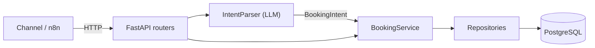

# booking-agent

[](https://github.com/Renan-Maciel-Santos/booking-agent/actions/workflows/ci.yml)


A conversational booking agent for **Northside Barbers**, a fictional barbershop.

The core idea is to keep the **LLM at the edge**. The model only turns a chat message
into a validated, structured `BookingIntent`. Every business rule (availability,
conflicts, rescheduling, cancellation) and all persistence run in a
**deterministic Python service layer on PostgreSQL**. The rationale is in
[ADR 0001](docs/adr/0001-llm-only-at-the-edge.md).

> Status: scaffold. Health checks, tooling, CI and the LLM port are in place.
> Domain features land in the next PRs (see [Roadmap](#roadmap)).

## Target architecture



The layers are `api` → `services` → `repositories` → `database`. External providers
sit behind ports in `domain/ports.py` and are implemented in `integrations/`. The
full design is in [docs/design-doc.md](docs/design-doc.md).

## Quick start (Docker)

```bash
cp .env.example .env          # then change POSTGRES_PASSWORD
docker compose up --build -d
curl http://localhost:8000/health/ready
# {"status":"ok","checks":{"database":"ok"}}
```

The API docs are served at <http://localhost:8000/docs>.

### Health endpoints

| Endpoint          | Purpose                                   | Checks database |
|-------------------|-------------------------------------------|-----------------|
| `GET /health/live`  | Liveness: the process is up             | No              |
| `GET /health/ready` | Readiness: the app can serve traffic    | Yes (503 if down) |
| `GET /health`       | Alias of `/health/ready`                | Yes             |

## Local development

Requirements: [uv](https://docs.astral.sh/uv/), Python 3.12 and Docker (for the
database and integration tests).

```bash
uv sync                                   # install runtime + dev dependencies
uv run pre-commit install                 # enable git hooks
docker compose up -d db                   # start only PostgreSQL
uv run uvicorn booking_agent.main:create_app --factory --reload
```

Migrations (no tables exist yet):

```bash
uv run alembic upgrade head
uv run alembic revision --autogenerate -m "describe change"
```

## Tests and quality checks

```bash
uv run ruff check .
uv run ruff format --check .
uv run mypy
uv run pytest -m unit          # fast, no external dependencies
uv run pytest -m integration   # real PostgreSQL via testcontainers (needs Docker)
uv run pytest                  # everything
```

Integration tests **fail** rather than skip when Docker is unavailable, so a
missing daemon can never look like a green build.

## Project structure

```
src/booking_agent/
├── api/                 # FastAPI routers (controllers), schemas, DI wiring
├── services/            # Business rules (deterministic)
├── repositories/        # Only layer with database access
├── domain/              # BookingIntent model and ports (IntentParser)
├── integrations/llm/    # LLM adapters (implement domain ports)
├── database/            # Engine, sessions, declarative base
├── config.py            # Settings from environment variables
├── logging_config.py    # Structured JSON logging
└── main.py              # Application factory and lifespan
migrations/              # Alembic (async)
tests/
├── unit/                # Fakes only, no I/O
├── integration/         # Real PostgreSQL (testcontainers)
└── fakes/               # Test doubles (FakeIntentParser, ...)
docs/                    # Design doc and ADRs
```

## Roadmap

- [x] Scaffold: layout, tooling, CI, Docker, health checks, `IntentParser` port
- [ ] Schema and repositories (customers, services, appointments, conversation_state)
- [ ] Double-booking protection with a PostgreSQL exclusion constraint
- [ ] `BookingService`: availability, book, reschedule, cancel
- [ ] OpenAI structured-output adapter + evaluation set
- [ ] Conversation state machine and message endpoint
- [ ] Observability: request IDs, metrics, audit log
- [ ] Security hardening: API authentication and rate limiting

## License

[MIT](LICENSE)
