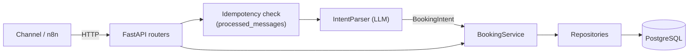

# booking-agent

[](https://github.com/Renan-Maciel-Santos/booking-agent/actions/workflows/ci.yml)


A conversational booking agent for **Northside Barbers**, a fictional barbershop.

The core idea is to keep the **LLM at the edge**. The model only turns a chat message
into a validated, structured `BookingIntent`. Every business rule (availability,
conflicts, rescheduling, cancellation) and all persistence run in a
**deterministic Python service layer on PostgreSQL**. The rationale is in
[ADR 0001](docs/adr/0001-llm-only-at-the-edge.md).

> Status: BookingService implemented with deterministic scheduling, availability, and double-booking protection.
> OpenAI adapter and conversation flows land in the next PRs (see [Roadmap](#roadmap)).

## Tech stack

| Technology | Role |
|---|---|
| **Python 3.12** | Core runtime environment |
| **FastAPI** | Asynchronous HTTP API routing and validation |
| **Pydantic v2 + pydantic-settings** | Domain schemas, intent validation, and environment configuration |
| **SQLAlchemy 2 (async) + asyncpg** | Asynchronous ORM and high-performance PostgreSQL driver |
| **Alembic** | Async database schema migrations |
| **PostgreSQL 16 + btree_gist** | Relational database with exclusion constraints for double-booking protection |
| **OpenAI Agents SDK** | Structured output parsing (adapter pending) |
| **n8n** | Channel adapter forwarding WhatsApp messages to the API |
| **Docker + Docker Compose** | Container runtime and local multi-service orchestration |
| **uv** | Fast Python package and project manager |
| **Ruff** | Fast Python linter and code formatter |
| **Mypy (strict)** | Static type checking enforcing strict mode |
| **pytest + pytest-asyncio + testcontainers** | Unit and integration testing against real PostgreSQL containers |
| **pre-commit** | Git hooks enforcing style, linting, and type consistency |
| **GitHub Actions** | Automated CI pipeline running lint, format, type-check, and tests |

## Target architecture



n8n acts as an external channel adapter, receiving raw webhook events from WhatsApp, normalizing payloads, and forwarding HTTP requests to the API.

The layers are `api` → `services` → `repositories` → `database`. External providers
sit behind ports in `domain/ports.py` and are implemented in `integrations/`. The
full design is in [docs/design-doc.md](docs/design-doc.md).

### Double-booking protection

Appointments are protected against concurrent double bookings directly at the database level using a PostgreSQL exclusion constraint with `btree_gist`:

```sql
EXCLUDE USING gist (
    barber_id WITH =,
    tstzrange(starts_at, ends_at, '[)') WITH &&
)
WHERE (status = 'confirmed');
```

This enforces mutual exclusion across overlapping intervals using half-open ranges `[)`, permitting adjacent appointments (e.g. 10:00–10:30 and 10:30–11:00) while rejecting overlapping bookings under concurrent requests with SQLSTATE `23P01`, which `AppointmentRepository` translates into a domain `SlotUnavailableError`. See [ADR 0002](docs/adr/0002-double-booking-exclusion-constraint.md) for full architectural rationale and trade-offs.

## Quick start (Docker)

```bash
cp .env.example .env          # then change POSTGRES_PASSWORD
docker compose up --build -d
curl http://localhost:8000/health/ready
# {"status":"ok","checks":{"database":"ok"}}
```

The API docs are served at <http://localhost:8000/docs>.

### Health endpoints

| Endpoint          | Purpose                                   | Checks database |
|-------------------|-------------------------------------------|-----------------|
| `GET /health/live`  | Liveness: the process is up             | No              |
| `GET /health/ready` | Readiness: the app can serve traffic    | Yes (503 if down) |
| `GET /health`       | Alias of `/health/ready`                | Yes             |

## Local development

Requirements: [uv](https://docs.astral.sh/uv/), Python 3.12 and Docker (for the
database and integration tests).

```bash
uv sync                                   # install runtime + dev dependencies
uv run pre-commit install                 # enable git hooks
docker compose up -d db                   # start only PostgreSQL
uv run uvicorn booking_agent.main:create_app --factory --reload
```

Database migrations and seeds:

```bash
uv run alembic upgrade head
uv run alembic revision --autogenerate -m "describe change"

# Populate demo business hours (Tuesday–Saturday 09:00–19:00):
docker compose exec -T db psql -U postgres -d postgres < db/seeds/business_hours.sql
```

## Tests and quality checks

```bash
uv run ruff check .
uv run ruff format --check .
uv run mypy
uv run pytest -m unit          # fast, no external dependencies
uv run pytest -m integration   # real PostgreSQL via testcontainers (needs Docker)
uv run pytest                  # everything
```

Integration tests **fail** rather than skip when Docker is unavailable, so a
missing daemon can never look like a green build.

## Project structure

```
src/booking_agent/
├── api/                 # FastAPI routers (controllers), schemas, DI wiring
├── services/            # Business rules (deterministic)
├── repositories/        # Only layer with database access
├── domain/              # BookingIntent model and ports (IntentParser)
├── integrations/llm/    # LLM adapters (implement domain ports)
├── database/            # Engine, sessions, declarative base
├── config.py            # Settings from environment variables
├── logging_config.py    # Structured JSON logging
└── main.py              # Application factory and lifespan
migrations/              # Alembic (async)
tests/
├── unit/                # Fakes only, no I/O
├── integration/         # Real PostgreSQL (testcontainers)
└── fakes/               # Test doubles (FakeIntentParser, ...)
docs/                    # Design doc and ADRs
```

## Roadmap

- [x] Scaffold: layout, tooling, CI, Docker, health checks, `IntentParser` port
- [x] Schema and repositories (customers, services, barbers, appointments, conversation_states, processed_messages)
- [x] Double-booking protection with a PostgreSQL exclusion constraint
- [x] `BookingService`: availability, book, reschedule, cancel
- [ ] OpenAI structured-output adapter + evaluation set
- [ ] Conversation state machine and message endpoint
- [ ] Observability: request IDs, metrics, audit log
- [ ] Security hardening: API authentication and rate limiting

## License

[MIT](LICENSE)
