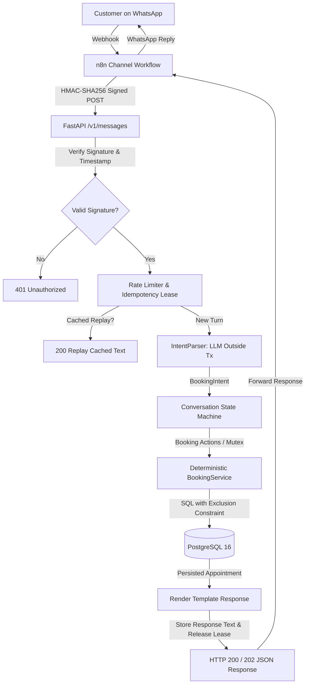

# booking-agent

[](https://github.com/Renan-Maciel-Santos/booking-agent/actions/workflows/ci.yml)


A conversational booking agent for **Northside Barbers**, a fictional barbershop.

The central architecture keeps the **LLM strictly at the edge**: language models interpret informal customer messages into structured, validated intent data (`BookingIntent`), while all business rules, availability checks, state transitions, and database writes remain 100% deterministic in Python on PostgreSQL. The design rationale is documented in [ADR 0001](docs/adr/0001-llm-only-at-the-edge.md).

> **Project Status**: Complete portfolio demonstration prototype featuring an end-to-end architecture from WhatsApp channel webhook to PostgreSQL exclusion constraints. All core milestones are implemented and verified with automated test suites.

## Demo

<!-- Demo recording placeholder -->
> **Demo Preview**: *(Recording placeholder — run `scripts/demo_conversation.py` to see the live interaction)*

```text
====================================================================
    Northside Barbers - Conversational Booking Demonstration
====================================================================

Connecting to: http://localhost:8000
Customer Phone: +5511999998888

--- Turn 1/7 ---------------------------------
Customer 👤: Olá! Gostaria de agendar um corte para sexta-feira, 23/10 às 15h.
             HTTP 200 | Round-trip: 53.5ms
Bot 💈:     Por favor, qual é o seu nome para o agendamento?

[Idempotency Verification] Replaying Turn 1 with identical message_id...
[PASS] Idempotent replay returned HTTP 200 with identical cached text (60.5ms).

--- Turn 2/7 ---------------------------------
Customer 👤: Renan Maciel
             HTTP 200 | Round-trip: 91.5ms
Bot 💈:     Podemos confirmar? Agendamento de Corte de Cabelo em 23/10 às 15:00 com qualquer barbeiro disponível para Renan Maciel. Valor: R$ 45,00. (Responda 'sim' para confirmar ou informe se deseja mudar algo)

--- Turn 3/7 ---------------------------------
Customer 👤: Sim
             HTTP 200 | Round-trip: 46.3ms
Bot 💈:     Perfeito, Renan Maciel! Seu horário para Corte de Cabelo está confirmado para 23/10 às 15:00 com Bruno. Te esperamos lá!

--- Turn 4/7 ---------------------------------
Customer 👤: Gostaria de remarcar para sábado, 24/10 às 16h.
             HTTP 200 | Round-trip: 57.8ms
Bot 💈:     Podemos confirmar a remarcação de Corte de Cabelo de 23/10 às 15:00 para 24/10 às 16:00?

--- Turn 5/7 ---------------------------------
Customer 👤: Confirmado
             HTTP 200 | Round-trip: 39.7ms
Bot 💈:     Seu agendamento foi remarcado com sucesso para 24/10 às 16:00 com Bruno!

--- Turn 6/7 ---------------------------------
Customer 👤: Preciso cancelar meu agendamento.
             HTTP 200 | Round-trip: 74.3ms
Bot 💈:     Deseja realmente cancelar seu agendamento de Corte de Cabelo no dia 24/10 às 16:00 com Bruno?

--- Turn 7/7 ---------------------------------
Customer 👤: Sim, pode cancelar.
             HTTP 200 | Round-trip: 87.3ms
Bot 💈:     Seu agendamento de Corte de Cabelo no dia 24/10 às 16:00 foi cancelado com sucesso.

All 7 conversation turns completed successfully! 🎉
```

## How it works

A customer message travels through the following sequence:



## Engineering highlights

- **The confirmation shown is the action executed**: The conversational state machine binds prompt rendering and action execution to a single typed pending flow and fully populated, typed `ConfirmationDetails`. Context-dependent confirmation tokens (e.g., "pode cancelar") are disambiguated by exhaustive matching so they only confirm pending cancellations and abort other operations. Any missing details or mid-confirmation flow changes (such as rescheduling instead of cancelling) fail safe to `IDLE` or transition to the updated flow without executing divergent actions. See [Issue #14](https://github.com/Renan-Maciel-Santos/booking-agent/issues/14) and [PR #12](https://github.com/Renan-Maciel-Santos/booking-agent/pull/12).
- **Double-booking exclusion constraint**: Guaranteed mutual exclusion across overlapping time intervals directly at the PostgreSQL level via `btree_gist` and `tstzrange` (`[)` half-open ranges). Even under high-concurrency race conditions, conflicting bookings are rejected by constraint `appointments_barber_slot_excl` with SQLSTATE `23P01`, converted into domain `SlotUnavailableError`. See [ADR 0002](docs/adr/0002-double-booking-exclusion-constraint.md).
- **Exact idempotency via `booking_actions`**: Mutating operations generate an `action_id` UUID recorded in `booking_actions` with foreign key `RESTRICT` to `appointments`. If network timeouts or duplicate requests trigger retries, existing completed actions are replayed without duplicating appointments or state mutations. See [ADR 0005](docs/adr/0005-conversation-flow-and-state-machine.md).
- **LLM execution outside database transactions**: External AI model inference runs entirely outside of database connection lifecycles and row locks. Database transactions are split into short, focused phases (lease acquisition, state transitions, action execution), preventing connection pool starvation during slow LLM calls. See [ADR 0005](docs/adr/0005-conversation-flow-and-state-machine.md).
- **HMAC-SHA256 with timestamp tolerance window**: Webhooks authenticate incoming payloads using HMAC-SHA256 signatures (`X-Signature: sha256=<hex>`) computed over a canonicalized body and Unix timestamp (`X-Timestamp`). Constant-time comparison and a 300s clock drift window prevent payload tampering and replay attacks before any JSON parsing occurs. See [ADR 0006](docs/adr/0006-message-endpoint-and-channel-integration.md).
- **Deterministic concurrency testing**: Concurrency protection is proven via deterministic test suites using `threading.Barrier` and `asyncio.Event` synchronization primitives rather than nondeterministic sleep delays. See [ADR 0005](docs/adr/0005-conversation-flow-and-state-machine.md) and [`test_conversation_concurrency.py`](tests/integration/test_conversation_concurrency.py).

## Quick start

### 1. Configure environment
Copy the template configuration:
```bash
# Unix / macOS
cp .env.example .env

# Windows (PowerShell)
Copy-Item .env.example .env
```

Generate a secure random 32-byte secret and update `WEBHOOK_SECRET` in `.env`:
```bash
# Unix / macOS (Python secrets module)
python3 -c "import secrets, pathlib; p = pathlib.Path('.env'); p.write_text(p.read_text().replace('change-me-to-a-secure-random-secret', secrets.token_hex(32)))"

# Windows (PowerShell with Python secrets module)
$secret = python -c "import secrets; print(secrets.token_hex(32))"
(Get-Content .env) -replace 'change-me-to-a-secure-random-secret', $secret | Set-Content .env
```

*(Native PowerShell variant without Python: `$bytes = New-Object byte[] 32; [Security.Cryptography.RandomNumberGenerator]::Create().GetBytes($bytes); $secret = ($bytes | ForEach-Object { "{0:x2}" -f $_ }) -join ''; (Get-Content .env) -replace 'change-me-to-a-secure-random-secret', $secret | Set-Content .env`)*

> [!NOTE]
> The application validates configuration during startup and refuses to start if `WEBHOOK_SECRET` begins with `change-me` (case-insensitive) or has fewer than 32 characters.

### 2. Build the application image
```bash
docker compose build app
```
Builds the container image, ensuring that both database migrations and the API run the latest application code.

### 3. Start PostgreSQL container
```bash
docker compose up -d db
```

### 4. Run database migrations
```bash
docker compose run --rm app alembic upgrade head
```

### 5. Seed demo data
Populate the barbershop catalog (barbers, services, operating hours):
```bash
# Unix / macOS / bash
docker compose exec -T db psql -U booking -d booking < db/seeds/demo.sql

# Windows (PowerShell)
Get-Content db/seeds/demo.sql | docker compose exec -T db psql -U booking -d booking
```
*Note: The demo seed is completely idempotent and safe to execute multiple times.*

### 6. Start the API
```bash
docker compose up -d app
```

Verify application readiness:
```bash
# Unix / macOS
curl http://localhost:8000/health/ready

# Windows (PowerShell)
curl.exe http://localhost:8000/health/ready
# {"status":"ok","checks":{"database":"ok"}}
```

The interactive OpenAPI docs are available at <http://localhost:8000/docs>.

### 7. Run the conversation demonstration
Execute the automated 7-turn conversation simulation with HMAC signature authentication and idempotency verification (the script automatically reads `WEBHOOK_SECRET` from the environment or `.env` file):
```bash
uv run python scripts/demo_conversation.py --idempotency-check
```

## Local development

Direct database access from the host (such as running migrations or the API directly via `uv`) requires starting the database container with the optional development compose file to expose the PostgreSQL port:

```bash
# Start PostgreSQL with host port exposure
docker compose -f docker-compose.yml -f docker-compose.dev.yml up -d db

# Apply migrations locally
uv run alembic upgrade head

# Start API server locally with auto-reload
uv run uvicorn booking_agent.main:create_app --factory --reload
```

Commands executed on the host connect to PostgreSQL outside the Docker network. They require `POSTGRES_HOST=localhost` and require `POSTGRES_PORT` to match `POSTGRES_HOST_PORT` from `.env` whenever the host port mapping differs from `5432`.

## Data retention

In compliance with data minimisation principles, personal data in stored message responses and dialogue state is pruned periodically through automated retention rules:

| Target | Rule | Configuration Setting | Default |
|---|---|---|---|
| `processed_messages.response_text` | Set to `NULL` (preserves `message_id` for deduplication) | `PROCESSED_MESSAGE_REDACT_AFTER_DAYS` | 7 days |
| `processed_messages` rows | Permanently deleted | `PROCESSED_MESSAGE_DELETE_AFTER_DAYS` | 90 days |
| `conversation_states` rows | Permanently deleted when inactive (excluding `executing` stage) | `CONVERSATION_STATE_DELETE_AFTER_DAYS` | 30 days |

### Command

Execute the one-shot purge job:
```bash
python -m booking_agent.jobs.retention
```

### Daily schedule example

Using `cron` (e.g. daily at 03:00):
```cron
0 3 * * * cd /path/to/booking-agent && docker compose run --rm app python -m booking_agent.jobs.retention
```

Using Docker Compose directly:
```bash
docker compose run --rm app python -m booking_agent.jobs.retention
```

## Tech stack

| Technology | Role |
|---|---|
| **Python 3.12** | Core runtime environment |
| **FastAPI** | Asynchronous HTTP API routing, dependencies, and validation |
| **Pydantic v2 + pydantic-settings** | Domain schemas, intent models, and environment settings |
| **SQLAlchemy 2 (async) + asyncpg** | Asynchronous ORM and PostgreSQL driver |
| **Alembic** | Async database schema migrations |
| **PostgreSQL 16 + btree_gist** | Relational database with exclusion constraints for double-booking protection |
| **OpenAI Agents SDK / API** | Structured output parsing (`gpt-4o-mini`) |
| **n8n** | Channel adapter forwarding WhatsApp messages to the API |
| **Docker + Docker Compose** | Container runtime and local orchestration |
| **uv** | Fast Python package and environment manager |
| **Ruff** | Code formatting and linting |
| **Mypy (strict)** | Strict static type checking |
| **pytest + testcontainers** | Unit and integration testing against real PostgreSQL containers |
| **pre-commit** | Git hooks enforcing style, linting, and type consistency |
| **GitHub Actions** | Automated CI pipeline running lint, format, type-check, and tests |

## Tests and quality checks

Requirements: Docker running (for PostgreSQL testcontainers).

```bash
uv run ruff check .               # linter
uv run ruff format --check .      # formatter
uv run mypy                       # strict static type check
uv run pytest -m unit             # fast unit tests (no external I/O)
uv run pytest -m integration      # integration tests against PostgreSQL containers
uv run pytest                     # complete test suite (281+ tests)
```

Integration tests **fail** rather than skip when Docker is unavailable, ensuring missing daemons cannot produce false-positive passes. The test suite runs in random order; the seed appears in the test header, and a failure is reproduced with `uv run pytest -p randomly --randomly-seed=<seed>`.

## Known limitations

- **In-memory rate limiting**: The current `PhoneRateLimiter` maintains sliding window request timestamps in application process memory (`app.state.rate_limiter`). In multi-instance or horizontal cluster deployments, a distributed store such as Redis is required to share rate-limit quotas across instances.
- **Out-of-order rapid messages**: If a customer sends multiple messages in sub-second bursts, network interleaving can cause messages to arrive at the API out of order. While idempotency leasing prevents simultaneous duplicate execution, sequential ordering relies on timestamp metadata.
- **Response text retention**: `processed_messages` stores the rendered `response_text` to enable instant idempotent replays. In high-volume production systems, a retention and archival pruning job should periodically purge old processed message records.
- **Automated live LLM evaluation**: While a golden evaluation set exists (`test_openai_intent_parser.py`) and passes unit verification, continuous automated evaluation against live OpenAI endpoints with cost and accuracy tracking is scheduled for future CI expansion.

## Roadmap

- [x] Scaffold: layout, tooling, CI, Docker, health checks, `IntentParser` port
- [x] Schema and repositories (customers, services, barbers, appointments, conversation_states, processed_messages, business_hours)
- [x] Double-booking protection with PostgreSQL exclusion constraint (`btree_gist`)
- [x] `BookingService`: availability, booking, rescheduling, and cancellation with atomic transactions
- [x] OpenAI structured-output adapter (`gpt-4o-mini`) + deterministic `FakeIntentParser`
- [x] Conversation state machine with 6-phase turn pipeline and fast-path confirmation
- [x] Webhook security: HMAC-SHA256 signature verification with timestamp tolerance window
- [x] In-memory sliding-window phone rate limiter with automatic stale key eviction
- [x] Channel integration: n8n workflow for WhatsApp webhook normalization and signing
- [x] Standalone multi-turn conversation CLI simulation (`scripts/demo_conversation.py`)
- [ ] Distributed rate limiting with Redis adapter for horizontal scaling
- [ ] Automated continuous evaluation pipeline benchmarking LLM accuracy and cost

## Project structure

```
src/booking_agent/
├── api/                 # FastAPI routers, schemas, security, middleware, rate limiter
├── services/            # Business rules (BookingService, ConversationService, EntityResolver)
├── repositories/        # Database access layer (parameterized async queries)
├── domain/              # BookingIntent model, enums, errors, and abstract ports
├── integrations/        # Adapters (OpenAI, FakeIntentParser, SystemClock)
├── database/            # Engine, session factory, declarative models, UnitOfWork
├── config.py            # Pydantic settings loaded from environment
├── logging_config.py    # Structured JSON logging configuration
└── main.py              # Application factory and lifespan management
migrations/              # Alembic async database migrations
db/seeds/                # Idempotent demo database seeds
integrations/n8n/        # n8n webhook workflow definition
scripts/                 # Showcase and simulation scripts
tests/
├── unit/                # Unit tests with test doubles (fakes, no I/O)
├── integration/         # Integration tests against PostgreSQL via testcontainers
└── fakes/               # Test doubles (FakeClock, FakeUnitOfWork, FakeIntentParser)
docs/                    # Design documentation and Architecture Decision Records (ADRs)
```

## License

[MIT](LICENSE)
