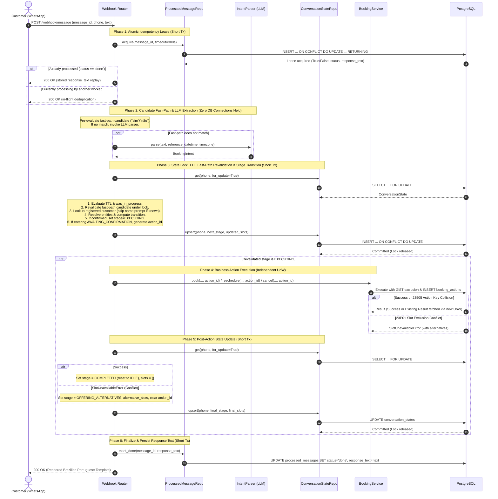

# ADR 0005: Conversation flow, state machine, confirmation, and turn orchestration

- **Status:** Accepted
- **Date:** 2026-10-20
- **Deciders:** Renan Maciel

## Context

The booking agent architecture establishes that the LLM is restricted to the system boundary as an untrusted parser ([ADR 0001](0001-llm-only-at-the-edge.md), [ADR 0004](0004-llm-adapter-and-evaluation.md)), while scheduling rules and concurrency guarantees reside in `BookingService` backed by PostgreSQL exclusion constraints ([ADR 0002](0002-double-booking-exclusion-constraint.md), [ADR 0003](0003-time-handling-and-rescheduling.md)).

Connecting these layers requires a multi-turn conversation orchestrator. In a real-world messaging channel (e.g. WhatsApp via webhooks), messages arrive asynchronously, users communicate in fragments across multiple turns ("Amanhã", "às 15h", "corte degradê"), webhook providers retry deliveries upon transient timeouts, and processes can crash at any step.

To deliver a reliable, deterministic booking experience without conversational hallucinations or duplicate bookings, several core architectural questions must be resolved:

1. **Dialogue State Representation:** How should multi-turn dialogue state be modeled, tracked, and persisted across turns without unbounded state accumulation or invalid state transitions?
2. **Turn Orchestration and Database Concurrency:** How should an incoming message turn be sequenced across idempotency checks, LLM parsing, state retrieval/mutation, and `BookingService` calls without holding open database locks or connections during slow external calls?
3. **Crash Recovery and Exact At-Most-Once Action Execution:** What happens if the service crashes between persisting dialogue state and action execution, or between action execution and response delivery? How are duplicate bookings prevented during webhook retries or rapid double confirmations without relying on fragile heuristic checks?
4. **Mandatory Confirmation and Intent Recognition:** Customers must never have an appointment booked without explicit consent. How should confirmation ("sim", "não") and mid-confirmation corrections ("na verdade às 16h") be detected efficiently and reliably?
5. **Entity Resolution:** How are free-text service and barber names extracted by the LLM mapped to database catalog records when users use slang, typos, or colloquial expressions?
6. **Multi-Appointment Management:** When a customer requests to reschedule or cancel but has multiple future bookings, how does the dialogue disambiguate the target appointment?
7. **Session Staleness (TTL):** How do we prevent stale dialogue states (e.g. a customer replying "sim" 24 hours later) from triggering unintended bookings?
8. **Response Generation:** How are customer-facing responses generated while guaranteeing tone consistency, Brazilian Portuguese localization, and zero LLM hallucination?

## Decision

We establish eight architectural decisions governing conversation flow, state transitions, turn orchestration, and customer communication:

### 1. Explicit State Machine with Strongly-Typed Stages (`ConversationStage`)

Conversation state is modeled as an explicit finite state machine with closed stages represented by a domain `StrEnum`:

- `IDLE`: No active booking, rescheduling, or cancellation flow. Initial state and state after flow completion or reset.
- `COLLECTING_BOOKING_DETAILS`: Incrementally eliciting and validating required booking slots (`service_id`, `local_date`, `local_time`, `barber_id`, `customer_name`).
  - *Customer Recognition Rule:* Before prompting for `customer_name`, the system queries `CustomerRepository.get_by_phone(phone)`. If the customer already exists in the database, `customer_name` is automatically loaded into state and the bot **never prompts the customer for their name**.
- `OFFERING_ALTERNATIVES`: The requested slot was unavailable; candidate alternative slots were proposed; awaiting user selection or new date/time.
- `AWAITING_CONFIRMATION`: All required slots are collected and verified available. A formatted summary is presented; awaiting explicit user confirmation ("sim" / "não" / correction).
  - *Action ID Generation:* Upon entering `AWAITING_CONFIRMATION`, a fresh `action_id = str(uuid4())` is generated and saved in `slots["action_id"]`.
- `EXECUTING`: The confirmation was accepted and locked in Phase 3. The orchestrator is actively performing the business action. Concurrent requests arriving while in `EXECUTING` receive a processing notice template (`REQUEST_PROCESSING`).
- `CHOOSING_APPOINTMENT`: Customer requested reschedule or cancellation and has two or more upcoming confirmed appointments; awaiting selection by ordinal or date/time.
- `COMPLETED`: Terminal stage of a flow after successful booking, rescheduling, or cancellation. Resets to `IDLE` upon turn completion.

State is persisted in `conversation_states` keyed by the customer's verified E.164 phone number (`phone`), with extracted entity data stored in a structured `slots` JSONB column.

**Post-Action State Transition Rule:**
When execution against `BookingService` finishes:
- **On Success:** Stage transitions from `EXECUTING` to `COMPLETED` (and resets to `IDLE`), `slots` is wiped (`{}`).
- **On Conflict (`SlotUnavailableError`):** Stage transitions from `EXECUTING` to `OFFERING_ALTERNATIVES`, records `slots["alternative_slots"] = exc.alternative_slots`, and removes `slots["action_id"]`.

### 2. Six-Phase Turn Orchestration with Short, Isolated Transactions

To ensure maximum concurrency and prevent resource starvation, turn orchestration strictly separates external network I/O from database transactions. A single message turn executes across six distinct phases:

1. **Phase 1 (Atomic Idempotency Lease):** Acquire processing rights for `message_id` via `ProcessedMessageRepository.acquire` in an independent short transaction.
   - If the message is already `status = 'done'`, the router retrieves `processed_messages.response_text` and replays the identical response with HTTP 200 OK.
   - If actively `processing` by an unexpired worker, returns HTTP 200 OK immediately to deduplicate in-flight requests.
2. **Phase 2 (Candidate Fast-Path Pre-Evaluation & LLM Extraction):** Pre-evaluates affirmative/negative fast-path tokens. If no match, invokes `IntentParser.parse`. **No database connection, transaction, or lock is held during this phase.**
3. **Phase 3 (State Lock, TTL, Fast-Path Revalidation & Slot Merge):** Open a short transaction. Retrieve the row with `SELECT ... FOR UPDATE` on `conversation_states.phone`.
   - Evaluates TTL: if expired, inspects `was_in_progress = (state.stage != IDLE or bool(state.slots))`. If in progress, selects `SESSION_EXPIRED`; if clean idle, selects `GREETING_HELP`.
   - **Fast-Path Revalidation under Lock:** A candidate fast-path confirmation is revalidated against the locked state: the stage must still be `AWAITING_CONFIRMATION` and `slots["action_id"]` must be present. If stage changed, candidate is discarded and message processed against locked state.
   - Auto-fills existing customer name if registered.
   - Resolves entities, merges slots, computes next stage, sets `stage = EXECUTING` upon affirmative confirmation, generates `action_id` if entering `AWAITING_CONFIRMATION`, and commits immediately (< 10ms), releasing the row lock.
4. **Phase 4 (Action Execution):** Executes only if stage transitioned to `EXECUTING`. Invokes `BookingService` passing `action_id`. `BookingService` executes inside its own dedicated Unit of Work, recording `(action_id, kind, appointment_id, result)` in `booking_actions` in the same transaction.
   - **Repository Concurrency Handling:**
     - Catches SQLSTATE `23505` (`unique_violation`) specifically on `booking_actions_pkey`. On collision, rolls back the failed transaction, opens a **new** unit of work, queries `booking_actions` for `action_id`, and returns the existing result successfully.
     - Catches SQLSTATE `23P01` (`exclusion_violation`) on `appointments_barber_slot_excl`, translated to `SlotUnavailableError`.
     - **No other integrity error is converted.**
5. **Phase 5 (Post-Action State Update):** In a short transaction with `SELECT ... FOR UPDATE`, updates `conversation_states` according to the execution result:
   - On Success: stage becomes `COMPLETED` (resets to `IDLE`) and `slots = {}`.
   - On Conflict (`SlotUnavailableError`): stage becomes `OFFERING_ALTERNATIVES`, records `slots["alternative_slots"]`, and clears `slots["action_id"]`.
6. **Phase 6 (Finalize & Persist Response Text):** In a final short transaction, updates `processed_messages` with `status = 'done'` and `response_text`, returning HTTP 200 OK with the rendered response.

### 3. Mandatory Confirmation and Hybrid Recognition Strategy

Appointments are never created without explicit customer confirmation. When all required slots are gathered, the system transitions to `AWAITING_CONFIRMATION` and presents a detailed summary (service, date, time, barber, price, customer name) asking "Posso confirmar?".

To optimize latency, reduce LLM costs, and support natural language corrections, confirmation is evaluated via a **hybrid strategy with Phase 3 lock revalidation**:

1. **Deterministic Fast-Path Pre-Evaluation (No LLM Call):**
   - If the user's message matches unambiguous affirmative tokens (`{"sim", "s", "ok", "confirmo", "confirmar", "pode confirmar", "fechado", "beleza", "isso", "com certeza"}`), an affirmative candidate is staged.
   - If the user's message matches unambiguous negative tokens (`{"não", "nao", "n", "cancela", "cancelar", "deixa", "esquece"}`), a negative candidate is staged.
2. **Phase 3 Lock Revalidation (Mandatory Guard):**
   - The candidate decision is only executed after acquiring the row lock on `conversation_states` and verifying that `stage == AWAITING_CONFIRMATION` and `action_id` is present.
   - If state has changed or expired, the candidate is discarded and the message is evaluated against the current state.
3. **LLM Extraction & Correction Path:**
   - If the message does not match exact tokens (e.g. "na verdade prefiro às 16h", "muda o barbeiro para o Carlos", "pode ser na sexta?"), the turn is routed to `IntentParser`.
   - The LLM extracts a `confirmation: Literal["yes", "no"] | None` field alongside any updated slot values.
   - If corrections are present (e.g. `local_time="16:00:00"`), the state machine updates the slot, verifies slot availability via `BookingService.list_availability`, and generates a **new** `action_id = str(uuid4())` (invalidating the prior unconfirmed offer), returning a new confirmation prompt.
   - If the user denies or requests changes that cannot be resolved, state transitions back to `COLLECTING_BOOKING_DETAILS` or `IDLE`.

**Design Rationale & Empirical Hypothesis:** In messaging channels, confirmations predominantly consist of concise affirmative/negative replies ("sim", "ok"). Bypassing the LLM drops response latency from ~1.5s to < 50ms and saves API costs, while lock revalidation guarantees state machine consistency, and LLM extraction seamlessly handles slot corrections.

### 4. Crash Resilience and Exact Database-Enforced Action Idempotency via `booking_actions`

Heuristic checks based on `(customer_phone, service_id, starts_at)` are fundamentally unsafe: phone numbers can be shared, rapid double "sim" messages can be processed across distinct message IDs, and in "any barber" mode, PostgreSQL's exclusion constraint does not prevent creating two appointments at the same time with different barbers.

We enforce **exact database-enforced action idempotency** via a dedicated table `booking_actions`:
- `action_id: uuid PRIMARY KEY`: Generated when entering `AWAITING_CONFIRMATION`.
- `kind: text NOT NULL CHECK (kind IN ('book', 'reschedule', 'cancel'))`
- `appointment_id: uuid NOT NULL REFERENCES appointments(id) ON DELETE CASCADE`
- `result: jsonb NOT NULL`
- `created_at: timestamptz NOT NULL DEFAULT now()`

Written in the **exact same transaction** as the appointment mutation (`INSERT` or `UPDATE`).

#### Concurrency and Failure Analysis for Analyzed Scenarios:

1. **Scenario 1: Two consecutive "sim" messages (different `message_id`s):**
   - *Behavior:* Because Phase 3 releases its row lock before Phase 4 begins, message 2 does NOT wait for message 1's Phase 4 to finish.
   - *Flow:*
     - If message 2 enters Phase 3 after message 1 committed `stage = EXECUTING`, message 2 acquires the lock, sees `stage == EXECUTING`, and immediately returns `REQUEST_PROCESSING` ("Seu pedido está sendo processado, por favor aguarde um instante.") without launching a second action.
     - If message 1 and message 2 evaluate Phase 3 concurrently and both advance to Phase 4 with the identical `action_id = A`:
       - Both invoke `BookingService.book(..., action_id=A)`.
       - Message 1 commits the appointment and writes `(action_id = A)` to `booking_actions`.
       - Message 2 attempts to write `action_id = A` and fails with SQLSTATE `23505` (`unique_violation` on `booking_actions_pkey`).
       - Message 2's repository aborts the transaction, opens a new unit of work, queries `booking_actions` for `action_id = A`, and returns the existing appointment result.
       - **Result:** Exactly one appointment is created in PostgreSQL, even in "any barber" mode where different barbers might otherwise be free at that hour.
2. **Scenario 2: Same "sim" message re-sent by the channel (identical `message_id`):**
   - In Phase 1, `ProcessedMessageRepository.acquire(message_id)` finds `status = 'done'`.
   - It returns the saved `response_text`. The router returns HTTP 200 with the exact same text. Zero LLM calls, zero state mutations, zero duplicate bookings.
3. **Scenario 3: Crash between saving state (Phase 3) and action execution (Phase 4):**
   - State was saved with `stage = EXECUTING` and `action_id = A`, but worker crashed before Phase 4.
   - `processed_messages` remains in `status = 'processing'`.
   - Upstream retries after lease timeout (300s). Re-execution in Phase 4 runs `book(..., action_id=A)`.
   - Since `booking_actions` does not yet contain `action_id = A`, the insert succeeds cleanly and advances to Phase 5 and Phase 6.
4. **Scenario 4: Crash between action execution (Phase 4) and marking message done (Phase 6):**
   - The appointment and `booking_actions` row with `action_id = A` were committed, but the worker crashed before Phase 6.
   - Upstream retries after lease timeout. Re-execution runs `book(..., action_id=A)`.
   - The repository catches the `action_id` conflict (SQLSTATE `23505`), loads the existing result from `booking_actions`, and returns it.
   - Phase 5 advances state to `COMPLETED`/`IDLE`, and Phase 6 updates `processed_messages` with `status = 'done'` and `response_text`, returning the confirmation to the customer. Exactly one appointment is created.
5. **Scenario 5: Delayed replay of an old reschedule after a newer reschedule:**
   - A customer reschedules an appointment from Oct 22 to Oct 23 (`action_id = R1`), committing `R1` to `booking_actions`.
   - Later, they reschedule to Oct 24 (`action_id = R2`), committing `R2` to `booking_actions`.
   - If network delay causes a duplicated webhook with `action_id = R1` to arrive late, `BookingService` detects that `R1` already exists in `booking_actions` (or catches `23505`). It returns the original result of `R1` without re-applying the old date to the appointment, safely preserving the newer Oct 24 slot.

### 5. Deterministic Catalog and Resource Resolution

Free-text entity names extracted by the LLM (`service_name`, `barber_name`) are resolved to primary keys strictly in deterministic service code:

- **Service Resolution:**
  1. Text normalization (lowercase, whitespace stripping, Unicode NFKD accent removal).
  2. Exact match against active `services.name`.
  3. Alias dictionary matching (e.g. "degradê", "fade", "social", "corte" -> "Corte de Cabelo"; "barboterapia", "fazer a barba" -> "Barba"; "combo", "completo" -> "Corte e Barba").
  4. Fuzzy string matching (Levenshtein / `SequenceMatcher`) with a strict similarity threshold ($\ge 0.80$).
  5. **Ambiguity / Zero Matches:** If zero matches are found, the bot lists active catalog services with pricing and asks the user to choose. If multiple services match closely, the bot presents the candidates for clarification.
- **Barber Resolution:**
  1. If `barber_name is None` or user states "qualquer um" / "sem preferência", `barber_id` resolves to `None` ("any available barber").
  2. First-name prefix and accent-normalized matching against active `barbers.name`.
  3. Fuzzy matching with threshold $\ge 0.80$.
  4. **Zero Matches:** Informs user the barber was not found, lists available active barbers, and offers "qualquer um".

### 6. Multi-Appointment Selection for Reschedule and Cancellation

Customers never reference database UUIDs. When a customer expresses intent to reschedule or cancel:

1. Query confirmed future appointments by verified customer phone:
   `SELECT * FROM appointments WHERE customer_id = :id AND status = 'confirmed' AND starts_at > clock.now() ORDER BY starts_at ASC`.
2. **Zero Appointments:** Informs the customer that no upcoming confirmed bookings were found, suggests booking a new appointment, and resets stage to `IDLE`.
3. **Single Appointment:** Automatically selects the appointment and proceeds directly to rescheduling (eliciting new date/time) or cancellation confirmation.
4. **Two or More Appointments:** Transitions to `CHOOSING_APPOINTMENT`. The bot presents a numbered list of appointments formatted with service name, localized date, time, and barber. The candidate IDs are stored in `slots["candidate_appointment_ids"]`. On the subsequent turn, the customer selects by number ("o 1", "o primeiro") or by specifying the date/time.

### 7. Time-to-Live (TTL) Conversation Expiration

To prevent stale context from corrupting new dialogues (e.g. a customer sending "sim" the next morning):

- A configurable timeout (`settings.conversation_ttl_minutes`, default `30` minutes) governs conversation freshness.
- In Phase 3, before processing any message, the orchestrator computes:
  `elapsed = clock.now() - state.updated_at`.
- If `elapsed > conversation_ttl`:
  - Inspects `was_in_progress = (state.stage != ConversationStage.IDLE.value or bool(state.slots))`.
  - State stage is reset to `IDLE` and `slots` is cleared to `{}`.
  - If `was_in_progress` is True: returns `SESSION_EXPIRED` (*"Olá! Sua sessão anterior expirou por inatividade. Como posso ajudar você hoje? (Agendar, remarcar ou cancelar)"*).
  - If `was_in_progress` is False (customer was already idle or contacting for the first time): returns standard `GREETING_HELP` (*"Olá! Sou o assistente da Northside Barbers. Posso ajudar você a agendar, remarcar ou cancelar seu horário. O que deseja fazer?"*).

### 8. Strictly Template-Based Responses in Brazilian Portuguese

In accordance with ADR 0001, the LLM **never** generates customer-facing reply text:

- All messages are generated from a deterministic template catalog (`src/booking_agent/services/templates.py`).
- **Timezone Localization:** All timestamps are converted from UTC to the business timezone (`America/Sao_Paulo`) before formatting.
- **Brazilian Locale Conventions:**
  - Dates: `DD/MM/YYYY` and localized friendly dates (e.g. "quinta-feira, 22 de outubro").
  - Times: Brazilian format `HH:MM` or `HHh` (e.g. `14:30`, `15h`).
  - Currency: Brazilian Real `R$ 45,00` formatted from `price_cents`.
- Eliminates tone drift, prompt injection leaks, and hallucinated booking guarantees.

## Consequences

### Positive
- **Predictable, auditable transitions:** The explicit enum state machine makes dialogue flow completely testable via unit tests without network or LLM dependencies.
- **Zero lock contention during LLM latency:** Decoupling LLM network calls from database transactions ensures PostgreSQL connection pool exhaustion cannot occur during provider slowdowns.
- **Exact database-enforced action idempotency:** Dedicated `booking_actions` table with `action_id PK` written in the same transaction guarantees at-most-once execution for the analyzed and tested scenarios, including in "any barber" mode, concurrent confirmations, and out-of-order retries of older reschedules.
- **Identical replay for duplicate deliveries:** Storing `response_text` in `processed_messages` allows completed duplicate deliveries to receive the exact same response instead of an empty status.
- **Fast-path safety via lock revalidation:** Pre-evaluating affirmative/negative tokens skips LLM latency (< 50ms vs ~1.5s), while revalidating under row lock prevents out-of-order execution.
- **Frictionless flow for registered customers:** Existing customers are recognized by phone number and never prompted for their name.
- **No false session expired notices:** Unprompted messages to idle sessions receive the standard greeting rather than confusing session expiration notices.
- **Localized and secure communication:** Fixed templates eliminate prompt injection vulnerabilities in customer replies and ensure strict Brazilian Portuguese formatting.

### Negative & Trade-offs
- **State machine rigidity:** Adding new conversational intents requires explicit state machine transitions and template definitions rather than prompt-only adjustments.
- **Multi-step transaction overhead:** Separating turn orchestration into distinct phases increases the number of short database transactions per turn from 1 to 2-3. However, each transaction lasts < 5ms, yielding significantly higher overall throughput than holding a single transaction across an LLM call.
- **Schema addition:** Requires a database migration to add `booking_actions` table and `response_text: text NULL` to `processed_messages`.
- **Known Limitations & Privacy (LGPD):** `processed_messages.response_text` stores personal data and requires an automated background cleanup routine to purge historical entries according to the retention policy.
