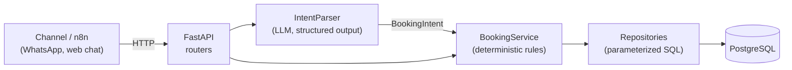
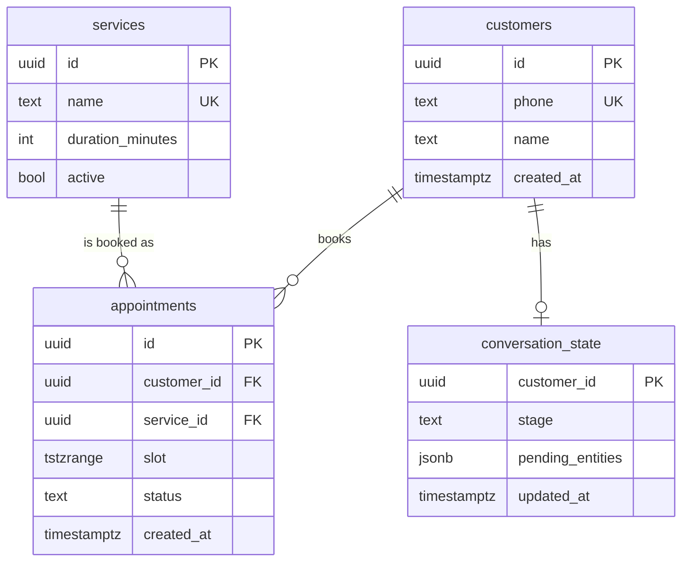

# Design Doc: Booking Agent

| Field   | Value                         |
|---------|-------------------------------|
| Author  | Renan Maciel                  |
| Status  | Draft (scaffold merged)       |
| Updated | 2026-10-15                    |

## 1. Context

Small service businesses take bookings through chat apps. Staff answer by hand,
which is slow, inconsistent and error-prone (double bookings, forgotten
cancellations). This project builds a conversational booking agent for a
fictional barbershop, **Northside Barbers**, to demonstrate a production-grade
architecture for LLM-backed transactional systems.

## 2. Goals

- Let customers book, reschedule and cancel appointments in natural language.
- Guarantee that every action respects business rules, whatever the LLM outputs.
- Prevent double booking, including under concurrent requests.
- Keep every decision auditable (messages, intents and actions persisted).
- Keep the LLM provider replaceable behind a single port.

## 3. Non-goals

- Payments and deposits.
- Multi-language support (English only for now).
- A web UI or admin dashboard.
- Multi-tenancy (one business per deployment).
- Direct integration with a messaging channel; an orchestrator (e.g. n8n) calls the API.

## 4. Architecture

Layers and responsibilities:

| Layer            | Package                      | Responsibility                                   |
|------------------|------------------------------|--------------------------------------------------|
| API              | `api/`                       | HTTP mapping, validation, status codes. No rules |
| Services         | `services/`                  | Business rules and orchestration                 |
| Domain           | `domain/`                    | Models (`BookingIntent`) and ports               |
| Repositories     | `repositories/`              | The only code that touches the database          |
| Integrations     | `integrations/llm/`          | Adapters for external providers                  |
| Infrastructure   | `database/`, `config.py`     | Engine, sessions, settings, logging              |

Dependencies point inwards: services depend on ports (`Protocol`s), never on
concrete adapters. Wiring happens in `api/dependencies.py`.

### Request flow (target)

1. The channel posts a message to the API.
2. `IntentParser` returns a validated `BookingIntent` or `UNKNOWN`.
3. `BookingService` loads `conversation_state`, merges the new entities and
   decides the next step (ask for missing data, propose slots, confirm).
4. Writes happen in a single transaction; database constraints reject conflicts.
5. The reply text is produced from templates by the service, not by the LLM.

## 5. Data model (draft)

Key integrity rule: an `EXCLUDE USING gist (slot WITH &&) WHERE (status = 'confirmed')`
constraint (with `btree_gist`) makes overlapping confirmed appointments impossible
at the database level, so a race between two requests cannot double book.

## 6. Alternatives considered

**LLM with free tool calling deciding everything.** The model would receive tools
like `check_availability` and `create_appointment` and decide the sequence.
Rejected because:

- Correctness would depend on the model following instructions on every call.
- It is hard to test deterministically and hard to audit.
- Prompt injection could trigger real actions.
- Cost and latency grow with multi-step tool loops.

See [ADR 0001](adr/0001-llm-only-at-the-edge.md).

**Rule-based NLU (regex/keywords) without an LLM.** Rejected: brittle with real
user language (typos, relative dates, slang). It remains an option for a cheap
pre-filter.

## 7. Risks and mitigations

| Risk                         | Mitigation                                                                  |
|------------------------------|-----------------------------------------------------------------------------|
| Hallucinated entities        | Strict Pydantic schema; service validates against real catalog and slots    |
| Double booking (concurrency) | DB exclusion constraint + transactions; conflict mapped to a friendly reply |
| Token cost                   | Single short extraction call; small model; no tool loops; usage logged      |
| Prompt injection             | LLM has no tools or data access; output limited to a closed schema          |
| Timezone bugs                | Only timezone-aware datetimes accepted; `timestamptz` everywhere            |
| LLM provider outage          | Timeouts and a graceful "try again" reply; provider behind a port           |

## 8. Milestones

1. **Scaffold** (this PR): layout, tooling, CI, health checks, `IntentParser` port.
2. **Schema and repositories**: migrations for the draft model, repositories with
   integration tests, exclusion constraint.
3. **BookingService**: availability, booking, rescheduling and cancellation rules.
4. **OpenAI adapter**: structured-output adapter with contract tests and evals.
5. **Conversation flow**: `conversation_state` state machine and message endpoint.
6. **Observability and hardening**: request IDs, metrics, rate limiting, auth.
