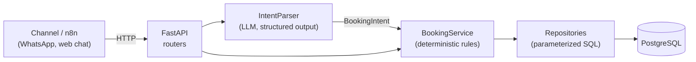
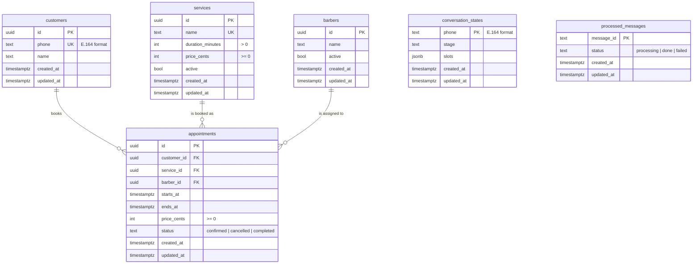

# Design Doc: Booking Agent

| Field   | Value                         |
|---------|-------------------------------|
| Author  | Renan Maciel                  |
| Status  | Draft (scaffold merged)       |
| Updated | 2026-10-15                    |

## 1. Context

Small service businesses take bookings through chat apps. Staff answer by hand,
which is slow, inconsistent and error-prone (double bookings, forgotten
cancellations). This project builds a conversational booking agent for a
fictional barbershop, **Northside Barbers**, to demonstrate a production-grade
architecture for LLM-backed transactional systems.

## 2. Goals

- Let customers book, reschedule and cancel appointments in natural language.
- Guarantee that every action respects business rules, whatever the LLM outputs.
- Prevent double booking, including under concurrent requests.
- Keep every decision auditable (messages, intents and actions persisted).
- Keep the LLM provider replaceable behind a single port.

## 3. Non-goals

- Payments and deposits.
- Multi-language support (English only for now).
- A web UI or admin dashboard.
- Multi-tenancy (one business per deployment).
- Direct integration with a messaging channel; an orchestrator (e.g. n8n) calls the API.

## 4. Architecture

Layers and responsibilities:

| Layer            | Package                      | Responsibility                                   |
|------------------|------------------------------|--------------------------------------------------|
| API              | `api/`                       | HTTP mapping, validation, status codes. No rules |
| Services         | `services/`                  | Business rules and orchestration                 |
| Domain           | `domain/`                    | Models (`BookingIntent`) and ports               |
| Repositories     | `repositories/`              | The only code that touches the database          |
| Integrations     | `integrations/llm/`          | Adapters for external providers                  |
| Infrastructure   | `database/`, `config.py`     | Engine, sessions, settings, logging              |

Dependencies point inwards: services depend on ports (`Protocol`s), never on
concrete adapters. Wiring happens in `api/dependencies.py`.

### Request flow (target)

1. The channel posts a message to the API.
2. `IntentParser` returns a validated `BookingIntent` or `UNKNOWN`.
3. `BookingService` loads `conversation_state`, merges the new entities and
   decides the next step (ask for missing data, propose slots, confirm).
4. Writes happen in a single transaction; database constraints reject conflicts.
5. The reply text is produced from templates by the service, not by the LLM.

## 5. Data model

### 5.1 Tables and Constraints

#### `processed_messages`
Guarantees idempotency for incoming webhook calls.
- **Columns**:
  - `message_id`: `text PRIMARY KEY` (channel/webhook message identifier)
  - `status`: `text NOT NULL` (`processing`, `done`, or `failed`)
  - `created_at`: `timestamptz NOT NULL DEFAULT now()`
  - `updated_at`: `timestamptz NOT NULL DEFAULT now()`
- **Constraints**:
  - `CHECK (status IN ('processing', 'done', 'failed'))`
- **Rationale & Mechanics**: In messaging channels like WhatsApp, network retries and webhook deduplication issues from upstream orchestrators (e.g. n8n or WhatsApp Cloud API) can deliver the exact same message multiple times. Without an idempotency layer at the edge, duplicate deliveries could trigger duplicate booking operations or corrupt the conversation state.
  - An atomic acquisition query (`INSERT ... ON CONFLICT (message_id) DO UPDATE ...`) ensures that only one worker acquires the message.
  - Messages in `failed` status can be retried immediately.
  - Messages stuck in `processing` can be reacquired after a configurable timeout (e.g., if a worker crashed before completing).

#### `customers`
Stores customer identity and contact information.
- **Columns**:
  - `id`: `uuid PRIMARY KEY DEFAULT gen_random_uuid()`
  - `phone`: `text NOT NULL UNIQUE` (customer identifier in E.164 format, e.g. `+1234567890`)
  - `name`: `text NOT NULL`
  - `created_at`: `timestamptz NOT NULL DEFAULT now()`
  - `updated_at`: `timestamptz NOT NULL DEFAULT now()`
- **Constraints**:
  - `CHECK (phone ~ '^\+[1-9]\d{1,14}$')` (enforces valid E.164 phone numbering)
- **Indexes**:
  - `pk_customers` on `id`
  - `uq_customers_phone` (unique) on `phone`
- **Creation Timing**: `customers.name` is `NOT NULL`. A customer record is created only at the moment of booking confirmation, once the customer's name has been elicited and validated during the conversation. Prior to booking, only `conversation_states` exists.

#### `services`
Catalog of barbershop services and pricing.
- **Columns**:
  - `id`: `uuid PRIMARY KEY DEFAULT gen_random_uuid()`
  - `name`: `text NOT NULL UNIQUE`
  - `duration_minutes`: `integer NOT NULL`
  - `price_cents`: `integer NOT NULL`
  - `active`: `boolean NOT NULL DEFAULT true`
  - `created_at`: `timestamptz NOT NULL DEFAULT now()`
  - `updated_at`: `timestamptz NOT NULL DEFAULT now()`
- **Constraints**:
  - `CHECK (duration_minutes > 0)`
  - `CHECK (price_cents >= 0)`
- **Indexes**:
  - `pk_services` on `id`
  - `uq_services_name` (unique) on `name`

#### `barbers`
The schedulable resource.
- **Columns**:
  - `id`: `uuid PRIMARY KEY DEFAULT gen_random_uuid()`
  - `name`: `text NOT NULL`
  - `active`: `boolean NOT NULL DEFAULT true`
  - `created_at`: `timestamptz NOT NULL DEFAULT now()`
  - `updated_at`: `timestamptz NOT NULL DEFAULT now()`
- **Indexes**:
  - `pk_barbers` on `id`
- **Rationale**: Even if Northside Barbers operates with a single chair initially, modeling `barbers` as a distinct entity decouples the business logic from a singleton assumption. It makes the double-booking exclusion constraint explicitly scoped per resource (`barber_id WITH =`), allows multiple staff members without future schema migrations, and cleanly separates staff management from customer accounts. Indexes on `active` are intentionally omitted until concrete query patterns require them.

#### `appointments`
Booked service instances for a specific customer, barber, and time slot.
- **Columns**:
  - `id`: `uuid PRIMARY KEY DEFAULT gen_random_uuid()`
  - `customer_id`: `uuid NOT NULL REFERENCES customers(id) ON DELETE RESTRICT`
  - `service_id`: `uuid NOT NULL REFERENCES services(id) ON DELETE RESTRICT`
  - `barber_id`: `uuid NOT NULL REFERENCES barbers(id) ON DELETE RESTRICT`
  - `starts_at`: `timestamptz NOT NULL`
  - `ends_at`: `timestamptz NOT NULL`
  - `price_cents`: `integer NOT NULL`
  - `status`: `text NOT NULL DEFAULT 'confirmed'`
  - `created_at`: `timestamptz NOT NULL DEFAULT now()`
  - `updated_at`: `timestamptz NOT NULL DEFAULT now()`
- **Constraints**:
  - `CHECK (ends_at > starts_at)`
  - `CHECK (price_cents >= 0)`
  - `CHECK (status IN ('confirmed', 'cancelled', 'completed'))`
  - `CONSTRAINT appointments_barber_slot_excl EXCLUDE USING gist (barber_id WITH =, tstzrange(starts_at, ends_at, '[)') WITH &&) WHERE (status = 'confirmed')` (requires `btree_gist`)
- **Indexes**:
  - `pk_appointments` on `id`
  - `ix_appointments_customer_id` on `customer_id`
  - `ix_appointments_barber_id_starts_at` on `barber_id, starts_at`
  - GiST index created automatically by the exclusion constraint
- **Service Layer Invariants**:
  - `price_cents`: Represents the price frozen at the exact time of booking. Future catalog price updates do not retroactively alter confirmed appointments.
  - `ends_at = starts_at + service.duration_minutes`: Computed and guaranteed by the `BookingService` layer before persisting.

#### `conversation_states`
Tracks multi-turn chat interaction state and extracted slot values per customer phone number.
- **Columns**:
  - `phone`: `text PRIMARY KEY` (E.164 phone number)
  - `stage`: `text NOT NULL DEFAULT 'idle'`
  - `slots`: `jsonb NOT NULL DEFAULT '{}'::jsonb`
  - `created_at`: `timestamptz NOT NULL DEFAULT now()`
  - `updated_at`: `timestamptz NOT NULL DEFAULT now()`
- **Constraints**:
  - `CHECK (phone ~ '^\+[1-9]\d{1,14}$')`
- **Decoupling from `customers`**: `conversation_states` has **no foreign key** to `customers`. Conversations frequently occur before a customer record exists (e.g. an unknown caller inquiring about services or starting a booking before their name is collected). Keying by phone number keeps dialogue state completely independent of customer profile creation.

### 5.2 Timestamp and Audit Rules
- **Database layer**: All timestamps are stored in UTC using PostgreSQL `timestamptz`. Repositories and SQL queries operate strictly in UTC without local conversions.
- **Service layer**: The business timezone (e.g. barbershop local time) is managed strictly within the service layer. It converts user-requested dates and times to UTC before querying or persisting, and formats UTC timestamps back to local time when generating customer responses.
- **`updated_at` management**: Updating `updated_at = now()` is the explicit responsibility of the repository layer on every SQL `UPDATE` statement. No database triggers are used, keeping data mutation logic explicit in application code.

### 5.3 Double-booking Prevention
Exclusivity is enforced at the database level through a PostgreSQL exclusion constraint with the `btree_gist` extension:
`EXCLUDE USING gist (barber_id WITH =, tstzrange(starts_at, ends_at, '[)') WITH &&) WHERE (status = 'confirmed')`.
The detailed architectural rationale, concurrency safety analysis, and error translation are documented in [ADR 0002](adr/0002-double-booking-exclusion-constraint.md).

## 6. Alternatives considered

**LLM with free tool calling deciding everything.** The model would receive tools
like `check_availability` and `create_appointment` and decide the sequence.
Rejected because:

- Correctness would depend on the model following instructions on every call.
- It is hard to test deterministically and hard to audit.
- Prompt injection could trigger real actions.
- Cost and latency grow with multi-step tool loops.

See [ADR 0001](adr/0001-llm-only-at-the-edge.md).

**Rule-based NLU (regex/keywords) without an LLM.** Rejected: brittle with real
user language (typos, relative dates, slang). It remains an option for a cheap
pre-filter.

## 7. Risks and mitigations

| Risk                         | Mitigation                                                                  |
|------------------------------|-----------------------------------------------------------------------------|
| Hallucinated entities        | Strict Pydantic schema; service validates against real catalog and slots    |
| Double booking (concurrency) | DB exclusion constraint + transactions; conflict mapped to a friendly reply |
| Token cost                   | Single short extraction call; small model; no tool loops; usage logged      |
| Prompt injection             | LLM has no tools or data access; output limited to a closed schema          |
| Timezone bugs                | Only timezone-aware datetimes accepted; `timestamptz` everywhere            |
| LLM provider outage          | Timeouts and a graceful "try again" reply; provider behind a port           |

## 8. Milestones

1. **Scaffold** (this PR): layout, tooling, CI, health checks, `IntentParser` port.
2. **Schema and repositories**: migrations for the draft model, repositories with
   integration tests, exclusion constraint.
3. **BookingService**: availability, booking, rescheduling and cancellation rules.
4. **OpenAI adapter**: structured-output adapter with contract tests and evals.
5. **Conversation flow**: `conversation_state` state machine and message endpoint.
6. **Observability and hardening**: request IDs, metrics, rate limiting, auth.
